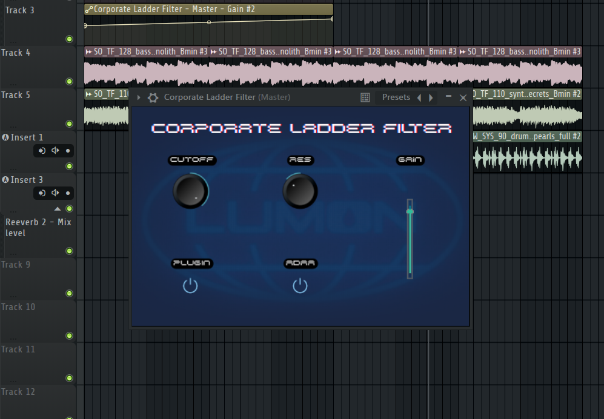
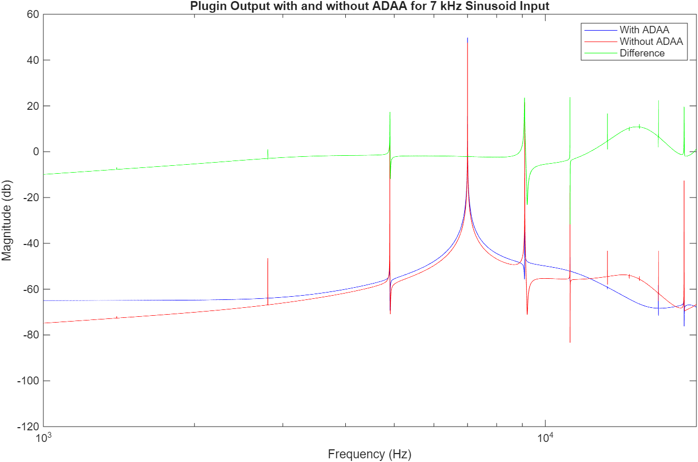

# Corporate Ladder Filter

*A digital emulation of the classic analog Moog ladder filter, built as a VST3/Standalone plugin. Named after the 'corporate ladder' and styled after a 70s retro-futurist aesthetic. Think Lumon Industries from Severance — clean, cold, corporate.*

[](https://github.com/swijewardane/corporate-ladder-filter/actions)




## Overview

Corporate Ladder Filter is a 4-pole Moog-style ladder filter plugin with cutoff, resonance, drive, and gain controls, built in JUCE/C++. It targets VST3 and Standalone formats on Windows, Linux, and macOS.

The distinguishing feature is **antiderivative antialiasing (ADAA)** applied to the tanh saturation stages on both the drive and feedback paths — this is what keeps the resonant, saturating filter free of aliasing artifacts at high resonance and drive settings, where a naive implementation would introduce audible digital distortion.

## Features

- Cutoff (20 Hz – 20 kHz, logarithmic) and resonance (0–100%, self-oscillating at the top of the range) knobs
- Drive/gain stage with tanh saturation
- ADAA toggle — compare aliased vs. antialiased saturation directly
- Plugin bypass
- Custom Lumon/*Severance*-inspired GUI with filmstrip-animated controls

## Signal Processing

The filter is a discrete-time 4-pole ladder structure with nonlinear feedback. Two places where naive digital implementation would alias:

1. **Drive stage** — tanh saturation applied directly to the signal
2. **Feedback path** — tanh bounds the feedback signal to (-1, 1), preventing runaway gain as resonance `k` approaches self-oscillation

Naively applying `tanh(x)` at each sample introduces aliasing because it's a nonlinear operation on a discrete-time signal. ADAA fixes this by computing the finite difference of the antiderivative of tanh — `F(x) = log(cosh(x))` — instead of the function directly:

```
y[n] = (F(x[n]) - F(x[n-1])) / (x[n] - x[n-1])
```

This produces the same saturation curve with substantially reduced aliasing, verified against harmonic distortion measurements taken during development (see `MATLAB/Figures/`).

<figure>
  
  <p align = "center"><em> Application of ADAA is shown to have measurable reduction in harmonics above the fundamental frequency </em> </p>
</figure>

## Resonance Scaling

In a ladder filter, the feedback amount `k` that tips the filter into self-oscillation depends on the cutoff frequency. A fixed 0–4 knob therefore reached self-oscillation well before its top at high cutoffs, and made for unsmooth cutoff frequency sweeps with abrupt self-oscillation.

The Resonance knob now spans 0–100% of the usable range at the current cutoff:

```
k = resonance × k_onset(cutoff) × 0.99
```

`k_onset` is found from the Barkhausen condition: oscillation starts at the frequency where the loop phase reaches −180°, and `k_onset = 1 / |loop gain|` at that frequency. The loop model includes the four one-pole stages, the one-sample feedback delay, and the extra half-sample delay and low-pass from ADAA. At runtime the plugin uses a 128-entry lookup table (20 Hz to 0.45·fs, log-spaced, one table each for ADAA on and off) with log-frequency interpolation, rebuilt whenever the sample rate changes. The 1% margin covers interpolation error, so the filter stops just short of free-running self-oscillation, though it still rings for a long time when kicked.

**Known limitation:** the one-sample feedback delay (plus ADAA's half-sample delay) pulls the resonant peak flat of the set cutoff at high frequencies. Fixing it would need a zero-delay-feedback restructure of the filter, which would make ADAA implementation more difficult.

## Development Process

This plugin was prototyped in MATLAB before being translated to a production JUCE/C++ plugin:

1. **Algorithm design & validation (MATLAB)** — the ladder filter, ADAA saturation, and GUI parameter mapping were built as a MATLAB `audioPlugin` class (`MATLAB/Functions_Subclasses/MoogLadderPlugin.m`), validated using exponential sine sweep measurements and Volterra/Hammerstein nonlinear system characterization to confirm the filter's nonlinear behavior matched expectations.
2. **Export** — the validated plugin was exported to a JUCE project via MATLAB's `generateAudioPlugin -juceproject`, which uses JUCE internally to generate a working C++ project from the MATLAB class.
3. **Refinement (JUCE/C++)** — the generated project was hand-refined: migrated from Projucer to a CMake build (via `FetchContent`), fixed a VST2/VST3 parameter automation conflict, corrected parameter default states, and updated GUI assets with the final Lumon-styled filmstrips and background. Later work added cutoff-resonance scaling and a cross-platform CI and release pipeline

See `MATLAB/` for the initial prototype, including validation scripts and measurement figures.

## Installation

Download the zip for your OS from the [latest release](https://github.com/swijewardane/corporate-ladder-filter/releases/latest)

Copy 'CorporateLadderFilter.vst3' to your VST3 folder, then rescan plugins in your DAW of choice. 

| OS | VST3 folder |
|---|---|
| Windows | `C:\Program Files\Common Files\VST3\` (needs administrator rights to copy) |
| macOS | `~/Library/Audio/Plug-Ins/VST3/` (or `/Library/Audio/Plug-Ins/VST3/` for all users) |
| Linux | `~/.vst3/` |

The macOS build is not code-signed and will be blocked the first time. After copying it, remove the download quarantine flag in your Terminal:

```bash
xattr -dr com.apple.quarantine ~/Library/Audio/Plug-Ins/VST3/CorporateLadderFilter.vst2
xattr -dr com.apple.quarantine /path/to/CorporateLadderFilter.app
```

The standalone plugin is 'CorporateLadderFilter.exe' and runs without a DAW.

## Building from Source

### Prereq's
- CMake > 3.22
- Git
- **Windows:** Visual Studio 2022 (Desktop development with C++ workload)
- **macOS:** Xcode command-line tools
- **Linux:** C++ compiler and JUCE's system packages ('libasound2-dev libx11-dev libxcomposite-dev libxcursor-dev libxext-dev libxinerama-dev libxrandr-dev libxrender-dev libxi-dev libfreetype-dev libfontconfig1-dev libgl1-mesa-dev`

### Steps

```bash
git clone https://github.com/swijewardane/corporate-ladder-filter.git
cd corporate-ladder-filter
cmake -B build -DCMAKE_BUILD_TYPE=Release
cmake --build build --config Release
```

## Project Structure

```
CorporateLadderFilter/
├── Source/          # JUCE/C++ plugin source
├── MATLAB/          # Original MATLAB prototype, validation scripts, figures
├── docs/            # Screenshots and supporting documentation
├── CMakeLists.txt
└── LICENSE
```

## Tech Stack

C++ · JUCE · CMake · MATLAB (Audio Toolbox) · GitHub Actions

## License

This project's source code is licensed under AGPLv3. It uses the [JUCE](https://github.com/juce-framework/JUCE) framework under its [AGPLv3 license terms](https://github.com/juce-framework/JUCE/blob/master/LICENSE.md).

## Acknowledgments

- [JUCE](https://juce.com/) — C++ audio application framework
- MathWorks Audio Toolbox — MATLAB plugin prototyping and `generateAudioPlugin` export
